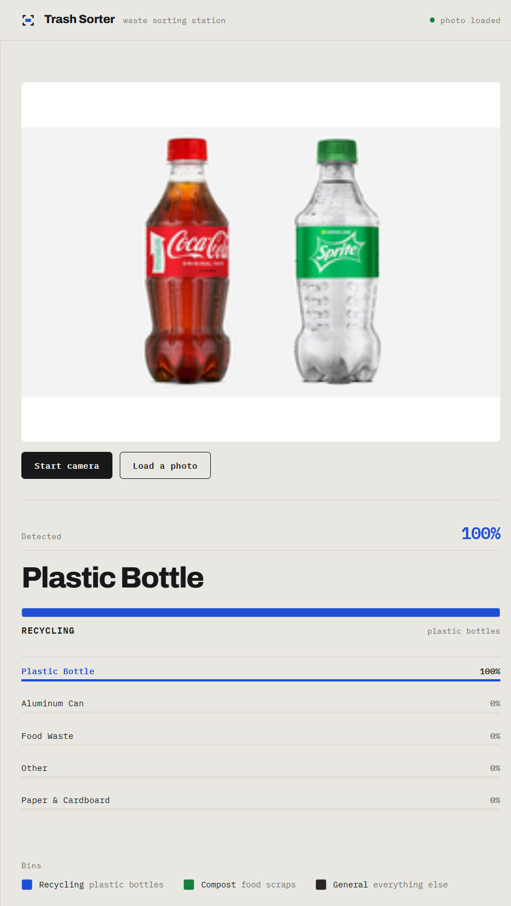
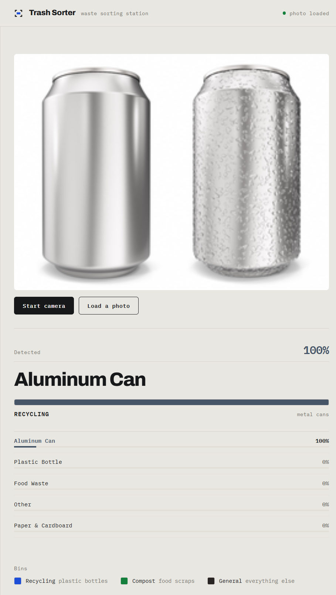
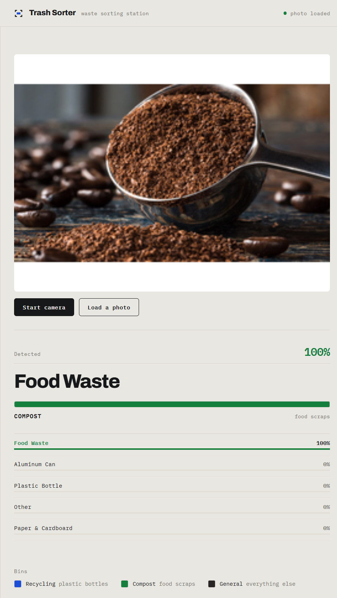
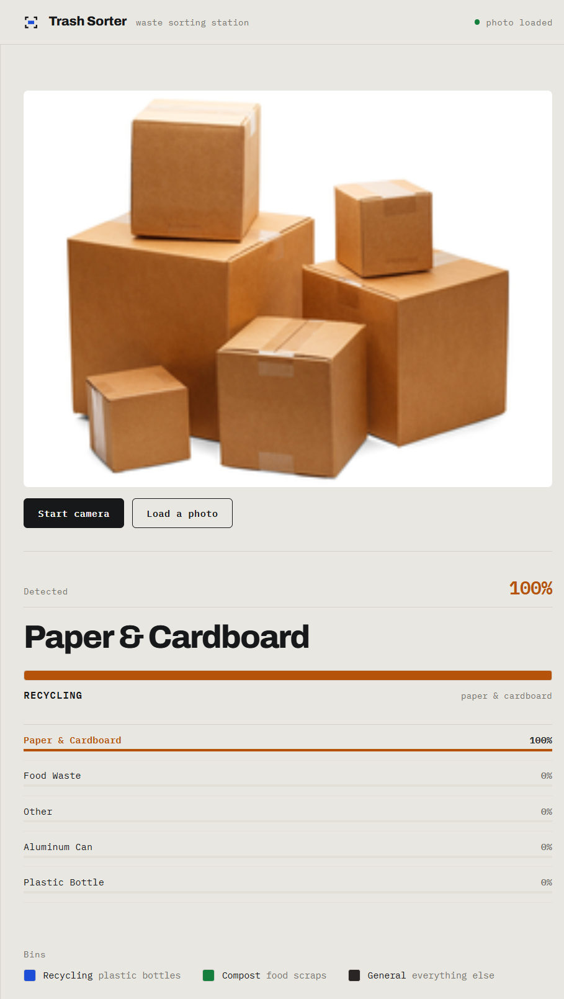

# Trash Sorter

**Point a camera at litter. Get told which bin it goes in.**

An AI waste-classification web app. A custom image model trained in
[Google Teachable Machine](https://teachablemachine.withgoogle.com/) runs entirely
in the browser on TensorFlow.js — no server, no API calls, no upload of camera
frames.

**Live demo →** **[trash-sorter.enjeanearz.workers.dev](https://trash-sorter.enjeanearz.workers.dev)**

---

## What it does



Point the webcam at an item and the app classifies it into one of five waste
classes, then tells you the destination bin. A **Load a photo** button does the
same from a still image, so the demo works even if camera permission is blocked.

| Detected class | Destination | Colour |
|---|---|---|
| Plastic Bottle | Recycling — plastic bottles | Blue |
| Aluminum Can | Recycling — metal cans | Slate |
| Paper & Cardboard | Recycling — paper & cardboard | Amber |
| Food Waste | Compost — food scraps | Green |
| Other | General — everything else | Graphite |

**Colour is the information, not decoration.** Each class carries the colour of
the bin it belongs in, the way municipal recycling signage already works, so the
answer is legible before you finish reading it. The bar under the verdict fills
to the model's confidence in that class's colour.

The mark is a camera viewfinder with the answer bar inside it — which is a
literal picture of what this app does: you point a camera at an item, and a
colour comes back.

<details>
<summary>More screenshots</summary>





</details>

---

## How it works

1. The model was **trained in Teachable Machine** as an image classifier over
   five classes, using 817 curated images (50 epochs, batch size 16,
   learning rate 0.001 — the defaults).
2. It was **exported as TensorFlow.js** into [`model/`](model).
3. [`app.js`](app.js) loads it with `@teachablemachine/image` and runs a
   prediction loop over the webcam frame (or the loaded photo) about five
   times a second.
4. The top class drives the verdict panel and the bin colour.

TensorFlow.js and the Teachable Machine library are **vendored into
[`vendor/`](vendor)**, including both webfonts, so the app works with no
internet connection — useful for a classroom demo on unreliable wifi.

## Stack

- Google Teachable Machine (model training + TensorFlow.js export)
- TensorFlow.js 3.21 (in-browser inference)
- Vanilla HTML, CSS and JavaScript — no build step, no framework
- Archivo + IBM Plex Mono (self-hosted)
- Cloudflare Workers (static hosting, auto-deploy from `main`)

## Run it locally

The camera API requires a secure context, so open it over `http://localhost`
rather than double-clicking `index.html`:

```bash
git clone https://github.com/zhameersheraz/trash-sorter.git
cd trash-sorter
python -m http.server 8000
```

Then open <http://localhost:8000> and allow camera access.

## Project structure

```
├── index.html            markup
├── styles.css            design system + layout
├── app.js                model loading, prediction loop, rendering
├── model/                exported TensorFlow.js model (required)
│   ├── model.json
│   ├── weights.bin
│   └── metadata.json     class labels + image size
├── vendor/               vendored libs and fonts (offline support)
├── docs/                 screenshots used by this README
└── .gitignore
```

---

## Notes for anyone extending this

The CDN build of `@teachablemachine/image` does **not** match Google's own export
snippet, and the mismatch is silent:

- The global is **`tmImage`** (lowercase). `TMImage` is undefined.
- There is no `loadFromURL`. `load(model, metadata)` is **async and
  Promise-returning** — passing callbacks makes it hang forever.
- `metadata` is mandatory, but `imageSize` must stay the **scalar** `224`.
  Passing `[224, 224]` yields NaN and every prediction dies with
  `Requested texture size [0x0] is invalid`.
- `predict()` returns classes in **training order**, not sorted by score. Only
  `predictTopK()` sorts. Sorting in `render()` is required or the headline
  result can show a 0% class while the real answer sits at 100%.

A `<video>` element also cannot decode a still image, so photo mode predicts
from a canvas at the image's intrinsic size.

## Accessibility notes

- The file input is clipped rather than `hidden`, so it stays keyboard-reachable;
  focus is drawn on the label that stands in for it.
- The verdict panel updates about five times a second, so it is **not** itself an
  `aria-live` region. A separate visually-hidden status element announces only
  when the winning class actually changes, instead of narrating every frame.
- `prefers-reduced-motion` disables all transitions.

## Dataset

Training images were curated from the
[Recyclable and Household Waste Classification](https://www.kaggle.com/datasets/alistairking/recyclable-and-household-waste-classification)
dataset by Alistair King (MIT licence), with unusable samples removed by hand.

---

Built by **Enjeanearz**.